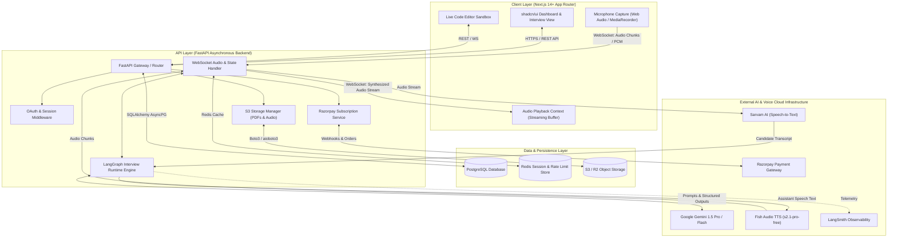
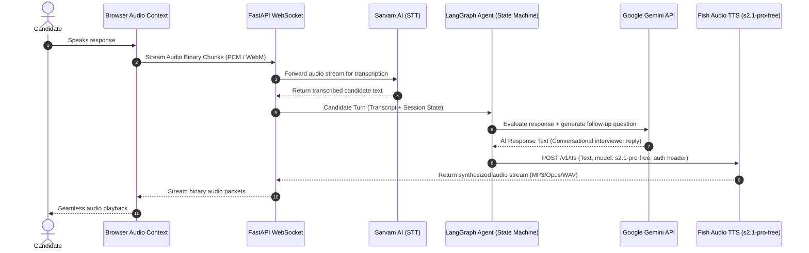
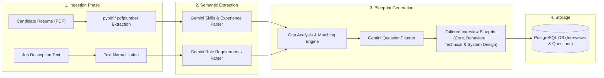

# InterviewOS — System Architecture

This document defines the high-level and detailed architecture for **InterviewOS**, an enterprise-grade AI mock interview platform featuring real-time conversational voice synthesis and adaptive question orchestration.

---

## 1. High-Level System Architecture

InterviewOS operates as a decoupled client-server architecture:
- **Client (Frontend):** Next.js App Router with TypeScript, Tailwind CSS, and shadcn/ui. Handles audio recording (MediaRecorder API / AudioWorklet), audio streaming playback, real-time code editor, and responsive analytical dashboards.
- **Server (Backend):** Python FastAPI application providing asynchronous REST endpoints and WebSockets for low-latency bidirectional voice and state interaction.
- **Data & Caching:** PostgreSQL for persistent relational storage with async SQLAlchemy and Alembic; Redis for fast session caches, rate limiting, and temporary audio buffer management (with in-memory fallback for lightweight local dev).
- **AI & Voice Services:**
  - **Sarvam AI STT:** Converts streaming audio input from the candidate into low-latency text transcripts.
  - **LangGraph & Gemini API:** State machine managing multi-turn interview flow, persona tracking, adaptive follow-ups, and question branching.
  - **Fish Audio TTS:** Synthesizes natural, low-latency speech from AI text using model `s2.1-pro-free` via backend-secured endpoint.

---

## 2. Voice Pipeline Architecture

The real-time voice pipeline provides conversational latency with adaptive turn-taking and graceful interruption handling. All external vendor traffic flows strictly through the backend to protect API keys.

### Voice Flow Sequence:
1. **Microphone Capture:** Candidate speaks; frontend captures audio using standard Web Audio API / MediaStream at 16kHz mono.
2. **Streaming Ingestion:** Audio packets are sent over a persistent WebSocket connection to the backend.
3. **STT Processing:** Backend streams audio bytes to **Sarvam AI STT API**, returning incremental candidate transcripts.
4. **Adaptive Orchestration:** When speech endpointing detects completion, the final transcript is dispatched to the **LangGraph Interview Agent**.
5. **LLM Inference:** LangGraph executes the current interview step, feeding conversation history and rubric context to **Gemini 1.5**.
6. **TTS Synthesis:** Gemini's generated response tokens or sentences are streamed directly to **Fish Audio TTS API** (`https://api.fish.audio/v1/tts`) using model `s2.1-pro-free`.
7. **Audio Streaming Playback:** Fish Audio returns synthesized audio stream bytes, forwarded via WebSocket down to the candidate browser for continuous gapless playback.

---

## 3. LangGraph Adaptive Interview State Machine

The conversational flow is modeled as a state graph with nodes for each phase of an interview. This architecture enables dynamic branching, clarifying questions, and deep-dive technical follow-ups.

```mermaid
stateDiagram-v2
    [*] --> InitializeSession: Candidate starts interview
    
    InitializeSession --> IntroduceInterviewer: Load Blueprint, Resume & Job Description
    IntroduceInterviewer --> AwaitCandidateResponse: Play intro via Fish Audio
    
    AwaitCandidateResponse --> TranscribeInput: Audio received via Sarvam STT
    TranscribeInput --> AnalyzeAnswer: LangGraph state update
    
    state AnalyzeAnswer {
        [*] --> CheckCompleteness
        CheckCompleteness --> NeedsClarification: Answer too brief or ambiguous
        CheckCompleteness --> FollowUpEligible: Solid answer; explore depth
        CheckCompleteness --> NextQuestionReady: Thorough answer; advance topic
    }
    
    NeedsClarification --> GenerateFollowUp: Ask targeted probing question
    FollowUpEligible --> GenerateFollowUp: Drill down into architectural details
    GenerateFollowUp --> StreamSpeech: Synthesize voice via Fish Audio
    StreamSpeech --> AwaitCandidateResponse: Candidate responds
    
    NextQuestionReady --> CheckInterviewProgress: Check time & question quota
    CheckInterviewProgress --> TransitionNextTopic: Topics remaining
    TransitionNextTopic --> StreamSpeech
    
    CheckInterviewProgress --> ConcludeInterview: All blueprint topics covered
    ConcludeInterview --> GenerateEvaluationReport: Trigger Gemini rubric evaluator
    GenerateEvaluationReport --> StoreReport: Save to PostgreSQL
    StoreReport --> [*]: Display report in UI
```

---

## 4. End-to-End Data Ingestion & Question Planning Flow

Prior to the voice interview, InterviewOS processes the candidate's resume and target job description to create an interview blueprint.

---

## 5. Architectural Considerations for 8 GB RAM Development

To guarantee smooth local development on an older Intel MacBook with 8 GB RAM, the following architectural choices are applied:

1. **Lightweight Monorepo / Decoupled Folders:** Frontend (`frontend/`) and Backend (`backend/`) exist in the same repository but execute as distinct processes without requiring heavy Docker containers.
2. **Native Environment Support:**
   - Backend runs directly in Python `venv` using `uvicorn` with reload.
   - Frontend runs via Next.js dev server (`npm run dev` or `pnpm dev`).
   - PostgreSQL and Redis can be run natively via Homebrew services or lightweight managed cloud instances (e.g. Neon, Supabase, Upstash), completely bypassing Docker memory overhead.
3. **Async Streaming Architecture:** FastAPI leverages async event loops (`asyncio` and `httpx.AsyncClient`) for high concurrency without blocking system threads or ballooning memory.
4. **Buffer Flushing:** Audio chunks are streamed directly between WebSockets and third-party APIs without accumulating large in-memory buffers on the backend.
