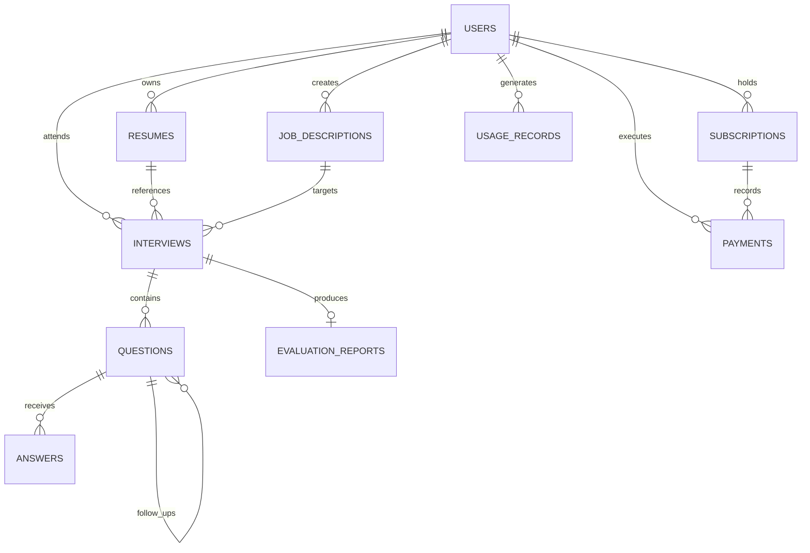

# InterviewOS — Database Design & Schema Specification

This document details the relational data model for **InterviewOS**. The schema is designed for **PostgreSQL 15+** utilizing async SQLAlchemy 2.0 and Alembic migrations.

---

## 1. Entity-Relationship Diagram (Mermaid)

---

## 2. Table Specifications & Schema Definitions

### 2.1 `users`
Core user identity table supporting Google OAuth authentication and role-based access.

| Column | Type | Constraints | Description |
| :--- | :--- | :--- | :--- |
| `id` | `UUID` | `PRIMARY KEY, DEFAULT gen_random_uuid()` | Unique user identifier |
| `email` | `VARCHAR(255)` | `NOT NULL, UNIQUE, INDEX` | Candidate email address |
| `full_name` | `VARCHAR(255)` | `NOT NULL` | Display name from OAuth |
| `avatar_url` | `TEXT` | `NULL` | Profile photo from Google |
| `oauth_provider` | `VARCHAR(50)` | `NOT NULL, DEFAULT 'google'` | Identity provider |
| `oauth_provider_id` | `VARCHAR(255)` | `NOT NULL, UNIQUE, INDEX` | Google sub / user identifier |
| `role` | `VARCHAR(50)` | `NOT NULL, DEFAULT 'candidate'` | Role: `candidate`, `recruiter`, `admin` |
| `current_tier` | `VARCHAR(50)` | `NOT NULL, DEFAULT 'free'` | Tier: `free`, `pro`, `enterprise` |
| `is_active` | `BOOLEAN` | `NOT NULL, DEFAULT TRUE` | Soft-disable account flag |
| `created_at` | `TIMESTAMPTZ` | `NOT NULL, DEFAULT NOW()` | Record creation timestamp |
| `updated_at` | `TIMESTAMPTZ` | `NOT NULL, DEFAULT NOW()` | Record update timestamp |

---

### 2.2 `resumes` (Implemented in Phase 03 — Migration `0003_resumes_and_jobs`)
Stores candidate resume files, safe storage references, and extracted text.

| Column | Type | Constraints | Description |
| :--- | :--- | :--- | :--- |
| `id` | `UUID` | `PRIMARY KEY, DEFAULT gen_random_uuid()` | Unique resume record ID |
| `original_filename` | `VARCHAR(255)` | `NOT NULL` | Original uploaded PDF filename |
| `storage_reference` | `VARCHAR(512)` | `NOT NULL` | Local/cloud storage path relative to upload root |
| `extracted_text` | `TEXT` | `NULL` | Plaintext extracted from PDF via `pypdf` |
| `processing_status` | `VARCHAR(50)` | `NOT NULL, DEFAULT 'completed', INDEX` | `completed`, `scanned_no_text`, `failed` |
| `file_size` | `INTEGER` | `NOT NULL` | Upload file size in bytes |
| `page_count` | `INTEGER` | `NULL, DEFAULT 0` | Total document pages |
| `word_count` | `INTEGER` | `NULL, DEFAULT 0` | Extracted word count |
| `user_id` | `UUID` | `NULL, INDEX` | Linked candidate user ID (ready for Phase 02 OAuth) |
| `created_at` | `TIMESTAMPTZ` | `NOT NULL, DEFAULT NOW()` | Upload timestamp |
| `updated_at` | `TIMESTAMPTZ` | `NOT NULL, DEFAULT NOW()` | Update timestamp |

---

### 2.3 `job_descriptions` (Implemented in Phase 03 — Migration `0003_resumes_and_jobs`)
Target roles and requirements against which mock interviews are calibrated.

| Column | Type | Constraints | Description |
| :--- | :--- | :--- | :--- |
| `id` | `UUID` | `PRIMARY KEY, DEFAULT gen_random_uuid()` | Unique job description ID |
| `title` | `VARCHAR(255)` | `NOT NULL, INDEX` | Job title (e.g. Senior Backend Engineer) |
| `company_name` | `VARCHAR(255)` | `NULL` | Target company (e.g. Google, Stripe) |
| `description_text` | `TEXT` | `NOT NULL` | Normalized text of job description |
| `word_count` | `INTEGER` | `NULL, DEFAULT 0` | Normalized word count |
| `user_id` | `UUID` | `NULL, INDEX` | Linked candidate user ID (ready for Phase 02 OAuth) |
| `created_at` | `TIMESTAMPTZ` | `NOT NULL, DEFAULT NOW()` | Creation timestamp |
| `updated_at` | `TIMESTAMPTZ` | `NOT NULL, DEFAULT NOW()` | Update timestamp |

---

### 2.4 `interviews`
Tracks individual mock interview sessions, type, state, and duration.

| Column | Type | Constraints | Description |
| :--- | :--- | :--- | :--- |
| `id` | `UUID` | `PRIMARY KEY, DEFAULT gen_random_uuid()` | Session UUID |
| `user_id` | `UUID` | `NOT NULL, REFERENCES users(id) ON DELETE CASCADE, INDEX` | Candidate ID |
| `resume_id` | `UUID` | `NULL, REFERENCES resumes(id) ON DELETE SET NULL` | Linked resume baseline |
| `job_description_id` | `UUID` | `NULL, REFERENCES job_descriptions(id) ON DELETE SET NULL` | Linked job description |
| `interview_type` | `VARCHAR(50)` | `NOT NULL, DEFAULT 'technical'` | `technical`, `system_design`, `behavioral`, `coding` |
| `status` | `VARCHAR(50)` | `NOT NULL, DEFAULT 'scheduled', INDEX` | `scheduled`, `in_progress`, `completed`, `cancelled` |
| `voice_enabled` | `BOOLEAN` | `NOT NULL, DEFAULT TRUE` | Whether voice interaction was toggled |
| `planned_duration_sec`| `INTEGER` | `NOT NULL, DEFAULT 1800` | Target length (default 30 mins) |
| `actual_duration_sec` | `INTEGER` | `NOT NULL, DEFAULT 0` | Elapsed interview duration in seconds |
| `started_at` | `TIMESTAMPTZ` | `NULL` | Actual start time |
| `ended_at` | `TIMESTAMPTZ` | `NULL` | Completion timestamp |
| `session_metadata` | `JSONB` | `NOT NULL, DEFAULT '{}'::jsonb` | LangGraph checkpoints and state metadata |
| `created_at` | `TIMESTAMPTZ` | `NOT NULL, DEFAULT NOW()` | Record creation timestamp |

---

### 2.5 `questions`
Planned blueprint questions and real-time dynamically generated follow-ups.

| Column | Type | Constraints | Description |
| :--- | :--- | :--- | :--- |
| `id` | `UUID` | `PRIMARY KEY, DEFAULT gen_random_uuid()` | Unique question ID |
| `interview_id` | `UUID` | `NOT NULL, REFERENCES interviews(id) ON DELETE CASCADE, INDEX` | Associated interview |
| `parent_question_id` | `UUID` | `NULL, REFERENCES questions(id) ON DELETE SET NULL` | If follow-up, parent question ID |
| `sequence_order` | `INTEGER` | `NOT NULL, DEFAULT 1` | Order in interview trajectory |
| `category` | `VARCHAR(50)` | `NOT NULL` | `system_design`, `algorithm`, `behavioral`, `deep_dive` |
| `difficulty` | `VARCHAR(50)` | `NOT NULL, DEFAULT 'medium'` | `easy`, `medium`, `hard` |
| `question_text` | `TEXT` | `NOT NULL` | Interviewer question text |
| `expected_criteria` | `JSONB` | `NOT NULL, DEFAULT '[]'::jsonb` | Rubric criteria to evaluate candidate answer |
| `is_follow_up` | `BOOLEAN` | `NOT NULL, DEFAULT FALSE` | Flag indicating dynamic follow-up |
| `created_at` | `TIMESTAMPTZ` | `NOT NULL, DEFAULT NOW()` | Creation timestamp |

---

### 2.6 `answers`
Stores candidate audio recordings, transcripts, response latency, and code submissions.

| Column | Type | Constraints | Description |
| :--- | :--- | :--- | :--- |
| `id` | `UUID` | `PRIMARY KEY, DEFAULT gen_random_uuid()` | Unique answer ID |
| `question_id` | `UUID` | `NOT NULL, REFERENCES questions(id) ON DELETE CASCADE, INDEX` | Evaluated question |
| `audio_s3_key` | `VARCHAR(512)` | `NULL` | S3 path to candidate audio recording |
| `transcript` | `TEXT` | `NOT NULL` | Sarvam STT generated candidate transcript |
| `code_submission` | `TEXT` | `NULL` | Code written during coding interview |
| `language` | `VARCHAR(50)` | `NULL` | Programming language (e.g. `python`, `typescript`) |
| `response_time_ms` | `INTEGER` | `NOT NULL, DEFAULT 0` | Candidate latency before speaking |
| `created_at` | `TIMESTAMPTZ` | `NOT NULL, DEFAULT NOW()` | Answer timestamp |

---

### 2.7 `evaluation_reports`
Comprehensive rubric-based assessment created at interview conclusion.

| Column | Type | Constraints | Description |
| :--- | :--- | :--- | :--- |
| `id` | `UUID` | `PRIMARY KEY, DEFAULT gen_random_uuid()` | Unique evaluation report ID |
| `interview_id` | `UUID` | `NOT NULL, UNIQUE, REFERENCES interviews(id) ON DELETE CASCADE, INDEX` | 1-to-1 link with interview |
| `overall_score` | `NUMERIC(4, 1)` | `NOT NULL` | Score out of 100 (e.g. 84.5) |
| `technical_score` | `NUMERIC(4, 1)` | `NOT NULL` | Technical depth score (0-100) |
| `communication_score`| `NUMERIC(4, 1)`| `NOT NULL` | Articulation and clarity score (0-100) |
| `problem_solving_score`| `NUMERIC(4, 1)`| `NOT NULL` | Analytical thinking score (0-100) |
| `confidence_score` | `NUMERIC(4, 1)` | `NOT NULL` | Pace, hesitation & delivery score (0-100) |
| `key_strengths` | `JSONB` | `NOT NULL, DEFAULT '[]'::jsonb` | Highlighting exceptional answers |
| `growth_areas` | `JSONB` | `NOT NULL, DEFAULT '[]'::jsonb` | Specific weaknesses and gaps |
| `detailed_breakdown`| `JSONB` | `NOT NULL, DEFAULT '{}'::jsonb` | Question-by-question breakdown |
| `actionable_plan` | `JSONB` | `NOT NULL, DEFAULT '[]'::jsonb` | 7-day personalized practice plan |
| `hiring_recommendation`| `VARCHAR(50)`| `NOT NULL` | `strong_no_hire`, `no_hire`, `hire`, `strong_hire` |
| `created_at` | `TIMESTAMPTZ` | `NOT NULL, DEFAULT NOW()` | Generation timestamp |

---

### 2.8 `subscriptions`
Customer subscription status linked to Razorpay subscriptions.

| Column | Type | Constraints | Description |
| :--- | :--- | :--- | :--- |
| `id` | `UUID` | `PRIMARY KEY, DEFAULT gen_random_uuid()` | Subscription UUID |
| `user_id` | `UUID` | `NOT NULL, REFERENCES users(id) ON DELETE CASCADE, INDEX` | Subscriber ID |
| `razorpay_subscription_id`| `VARCHAR(255)`| `NOT NULL, UNIQUE, INDEX` | Razorpay subscription reference |
| `plan_id` | `VARCHAR(100)` | `NOT NULL` | e.g. `plan_pro_monthly`, `plan_enterprise` |
| `status` | `VARCHAR(50)` | `NOT NULL, DEFAULT 'created', INDEX` | `created`, `active`, `paused`, `cancelled`, `expired` |
| `current_period_start`| `TIMESTAMPTZ` | `NOT NULL` | Billing cycle start |
| `current_period_end` | `TIMESTAMPTZ` | `NOT NULL` | Billing cycle renewal date |
| `cancel_at_period_end`| `BOOLEAN` | `NOT NULL, DEFAULT FALSE` | Flag for scheduled termination |
| `created_at` | `TIMESTAMPTZ` | `NOT NULL, DEFAULT NOW()` | Creation timestamp |
| `updated_at` | `TIMESTAMPTZ` | `NOT NULL, DEFAULT NOW()` | Update timestamp |

---

### 2.9 `payments`
Individual payment transactions, webhooks, and receipts.

| Column | Type | Constraints | Description |
| :--- | :--- | :--- | :--- |
| `id` | `UUID` | `PRIMARY KEY, DEFAULT gen_random_uuid()` | Unique payment record ID |
| `user_id` | `UUID` | `NOT NULL, REFERENCES users(id) ON DELETE CASCADE, INDEX` | Buyer ID |
| `subscription_id` | `UUID` | `NULL, REFERENCES subscriptions(id) ON DELETE SET NULL` | Linked subscription (if recurring) |
| `razorpay_order_id` | `VARCHAR(255)` | `NOT NULL, INDEX` | Razorpay order ID |
| `razorpay_payment_id`| `VARCHAR(255)`| `NULL, UNIQUE, INDEX` | Captured Razorpay payment ID |
| `razorpay_signature` | `VARCHAR(512)` | `NULL` | Cryptographic signature for webhook validation |
| `amount_in_cents` | `INTEGER` | `NOT NULL` | Amount in smallest currency unit (e.g. INR paise) |
| `currency` | `VARCHAR(10)` | `NOT NULL, DEFAULT 'INR'` | Transaction currency |
| `status` | `VARCHAR(50)` | `NOT NULL, DEFAULT 'pending', INDEX` | `pending`, `captured`, `failed`, `refunded` |
| `failure_reason` | `TEXT` | `NULL` | Gateway error message if failed |
| `created_at` | `TIMESTAMPTZ` | `NOT NULL, DEFAULT NOW()` | Timestamp |

---

### 2.10 `usage_records`
Fine-grained consumption tracking to enforce quotas and prevent API overuse.

| Column | Type | Constraints | Description |
| :--- | :--- | :--- | :--- |
| `id` | `UUID` | `PRIMARY KEY, DEFAULT gen_random_uuid()` | Unique usage log ID |
| `user_id` | `UUID` | `NOT NULL, REFERENCES users(id) ON DELETE CASCADE, INDEX` | User ID |
| `interview_id` | `UUID` | `NULL, REFERENCES interviews(id) ON DELETE SET NULL` | Related session |
| `metric_type` | `VARCHAR(50)` | `NOT NULL, INDEX` | `interview_sessions`, `audio_minutes`, `gemini_tokens` |
| `quantity` | `NUMERIC(10, 2)`| `NOT NULL, DEFAULT 1.0` | Quantity consumed |
| `billing_period` | `VARCHAR(7)` | `NOT NULL, INDEX` | Format: `YYYY-MM` (e.g. `2026-10`) |
| `created_at` | `TIMESTAMPTZ` | `NOT NULL, DEFAULT NOW()` | Event timestamp |

---

## 3. Database Indexes and Optimization Strategy

1. **Foreign Key Indexes:** Every foreign key column has an explicit B-Tree index to prevent table scans during cascading operations and joins.
2. **Compound Filtering Indexes:**
   - `idx_interviews_user_status`: `(user_id, status)` for user dashboard queries.
   - `idx_usage_user_period_metric`: `(user_id, billing_period, metric_type)` for ultra-fast quota verification before initiating interviews.
3. **JSONB GIN Indexes:**
   - `resumes.parsed_skills` with `jsonb_path_ops` for querying specific technology keywords.
   - `job_descriptions.required_skills` for matching algorithms.
