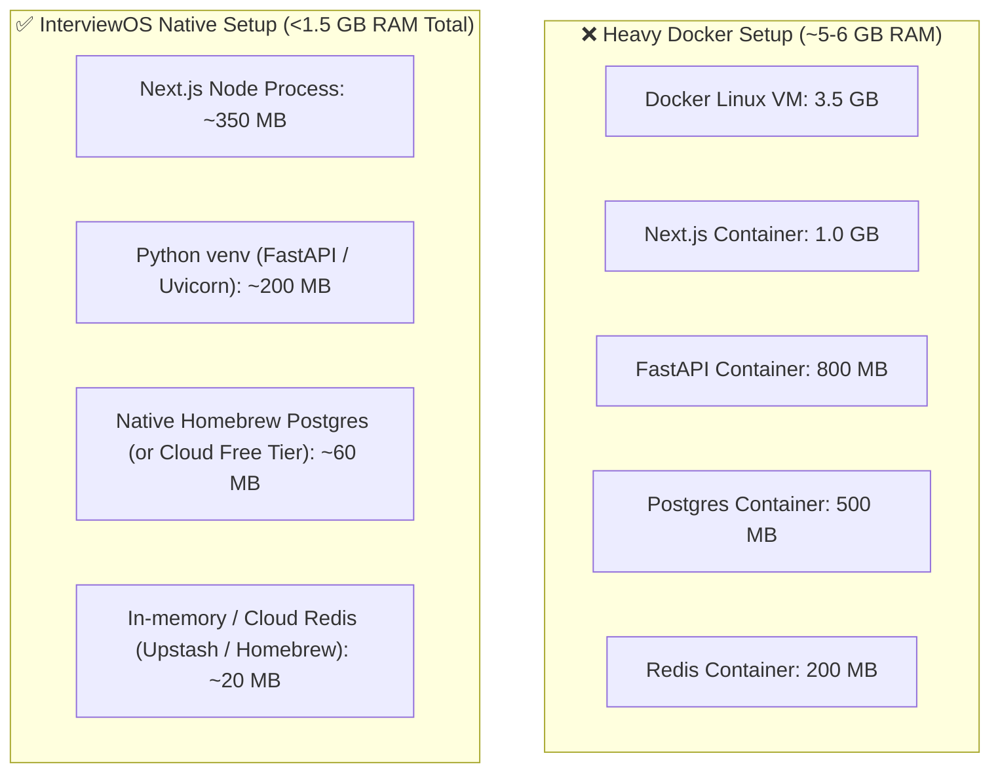

# InterviewOS — Technology Stack & Infrastructure Rationale

This document outlines the complete technology stack for **InterviewOS**, providing technical justifications, architectural roles, and explicit adaptations for developers running on constrained hardware (such as an 8 GB RAM Intel MacBook).

---

## 1. Stack Summary Table

| Category | Component / Library | Version / Variant | Purpose |
| :--- | :--- | :--- | :--- |
| **Frontend Framework** | Next.js (App Router) | 14+ / 15 | Server Components, routing, streaming SSR |
| **Frontend Language** | TypeScript | 5.x | End-to-end type safety |
| **Styling & UI System** | Tailwind CSS + shadcn/ui | Radix UI primitives | Accessible, modular, modern dark/light UI |
| **Audio Capture/Playback**| Web Audio API / MediaRecorder | Native Browser APIs | Low-latency binary PCM/WebM streaming |
| **Backend Framework** | FastAPI | 0.111+ | Asynchronous REST and WebSockets API |
| **Backend Language** | Python | 3.11+ | High-performance async runtime and AI SDKs |
| **Data Validation** | Pydantic v2 | 2.x | High-speed C-core schema validation |
| **ORM & Migrations** | SQLAlchemy 2.0 (Async) + Alembic | 2.0+ / 1.13+ | Non-blocking database access and versioning |
| **Primary Database** | PostgreSQL | 15+ | Acid compliance, JSONB documents, UUIDs |
| **Cache & Queue** | Redis / In-Memory Mock | Redis 7+ | Session state, rate limiting, quota lock |
| **Conversational AI** | Google Gemini API | 1.5 Pro & Flash | Multi-modal question planning & rubric scoring |
| **Agent Orchestration** | LangGraph & LangSmith | 0.2+ | State machine for multi-turn interview turns |
| **Speech-to-Text (STT)**| Sarvam AI | Cloud REST/WS | Low-latency speech recognition & transcription |
| **Text-to-Speech (TTS)**| Fish Audio | `s2.1-pro-free` | Expressive, low-latency AI interviewer voice |
| **Storage (Object)** | S3-Compatible Storage | AWS S3 / Cloudflare R2 | PDF resumes and audio interview recordings |
| **Payment Gateway** | Razorpay | Standard API | Indian & International recurring subscriptions |
| **Observability** | Sentry & LangSmith | Python/Next.js SDK | Error tracking, APM, and LLM tracing |

---

## 2. Component Deep-Dive & Justifications

### 2.1 Frontend: Next.js App Router + TypeScript + shadcn/ui
- **Next.js App Router:** Offers fine-grained streaming SSR, React Server Components for SEO-friendly public pages, and client components for interactive interview dashboards.
- **TypeScript:** Enforces strict contracts between backend Pydantic models and frontend state structures.
- **Tailwind CSS + shadcn/ui:** shadcn/ui provides clean, accessible Radix UI primitives without runtime CSS-in-JS overhead. This delivers modern aesthetics (dark mode, glassmorphism, fluid animations) while keeping bundle sizes small.

### 2.2 Backend: FastAPI + Pydantic v2 + SQLAlchemy (Async)
- **FastAPI:** Native support for asynchronous WebSockets allows concurrent streaming of microphone audio and synthesized voice without thread blocking.
- **Pydantic v2:** Rewritten in Rust, providing up to 20x performance improvement in JSON serialization and deserialization.
- **SQLAlchemy 2.0 Async:** Provides robust ORM querying with `asyncpg` driver, unlocking connection pooling and concurrent database requests without thread contention.

### 2.3 Voice Pipeline: Sarvam AI + Fish Audio
- **Sarvam AI (STT):** High accuracy with support for diverse accents, low Word Error Rates (WER), and fast turnaround on real-time conversational audio.
- **Fish Audio (TTS):**
  - **Endpoint:** `https://api.fish.audio/v1/tts`
  - **Target Model:** `s2.1-pro-free`
  - **Role:** Delivers expressive, low-latency voice synthesis that simulates a real human interviewer.
  - **Security Rule:** All TTS requests originate exclusively from the FastAPI backend. The frontend never accesses or receives `FISH_AUDIO_API_KEY`.

### 2.4 AI Engine: Google Gemini 1.5 + LangGraph
- **Gemini 1.5 Flash:** Used for real-time interview conversational turns where sub-second latency is critical.
- **Gemini 1.5 Pro:** Used for deep resume parsing, initial interview question planning, and post-interview comprehensive rubric evaluation.
- **LangGraph:** Enables cyclic conversational graphs where the AI interviewer can dynamically choose between probing follow-up questions, topic transitions, or polite clarifications.
- **LangSmith:** Full observability over LLM latency, token expenditure, and state transitions.

---

## 3. 8 GB RAM Intel MacBook Optimization Strategy

Developing modern full-stack AI applications on an older 8 GB RAM MacBook requires deliberate constraints to prevent memory swapping, thermal throttling, and system freezing.

### Strategic Guidelines for Low-RAM Operation:
1. **Docker is Strictly Optional:**
   - Avoid running Docker Desktop on macOS (which consumes 3+ GB of RAM just for its virtualized hypervisor).
   - Run backend directly inside a Python virtual environment (`python -m venv venv`).
   - Run frontend via native Node (`npm run dev` or `pnpm dev`).
2. **Database Options:**
   - Local: Lightweight Homebrew service (`brew services start postgresql@15`).
   - Cloud: Free-tier remote database (Neon Serverless PostgreSQL or Supabase) which consumes 0 MB of local RAM.
3. **Redis Optimization:**
   - Support a local lightweight in-memory cache fallback (`dict` / `fakeredis`) during development so running a Redis daemon is optional.
4. **Lean Dev Server Configuration:**
   - Next.js development server configured with `next dev -p 3000` with telemetry disabled.
   - Uvicorn configured with a single worker (`workers=1`) during development.
